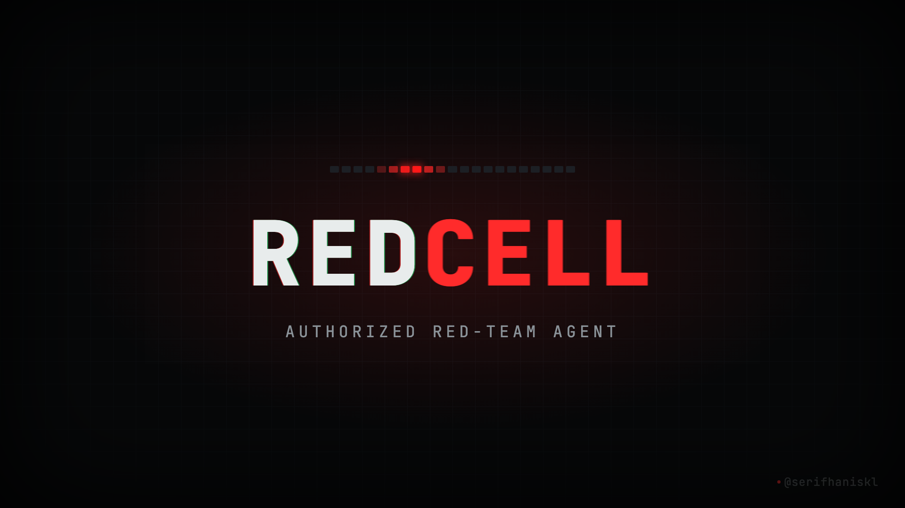

# redcell

<div align="center">

[](promo/out/redcell-promo.mp4)

Click the image to play the 26-second demo.

</div>

redcell is a framework for building an authorized, autonomous red-team agent in Python. It gives you the parts that are tedious to get right: a ReAct agent loop, swappable LLM providers, an MCP-style tool registry, a shared findings store, CVSS 4.0 scoring, and a scope and approval gate that sits in front of every action that touches a target.

The point of the scope gate is simple. The agent can only act against hosts and domains you have listed in `scope.yaml`, and by default it asks you before each action. Everything else is refused before a single packet leaves your machine.

Read this in Turkish: [README.tr.md](README.tr.md).

## Safety first

Use redcell only against systems you own or have written authorization to test. The target of every tool call is checked against your allowlist, and anything outside it is blocked and recorded in the run's audit log. If you are developing or experimenting, set `REDCELL_DRY_RUN=true` and the agent will reason and pick tools without executing any of them.

## Install

redcell needs Python 3.11 or newer.

```bash
python -m venv .venv
source .venv/bin/activate
pip install -e ".[dev]"
```

The base install runs against a local Ollama with no API key. Add extras when you need them:

```bash
pip install -e ".[anthropic]"   # Claude provider
pip install -e ".[cvss]"        # real CVSS 4.0 scoring
pip install -e ".[mcp]"         # connect external tool servers
pip install -e ".[neo4j]"       # graph state backend
```

Without the `cvss` extra, findings are still recorded, but their score shows as "not scored" in the report.

## Commands

```
redcell onboard                 write a starter .env
redcell scope init              write a starter scope.yaml
redcell tools                   list the registered tools
redcell run OBJECTIVE           run the agents against the current scope
redcell report                  render the findings store to Markdown
redcell bench scenarios.yaml    run benchmark scenarios
redcell version                 print the version
```

The `run` command takes a few options:

```
--router rule|llm   rule is deterministic (default); llm lets a model pick the next stage
--ui                show a live multi-agent dashboard instead of plain log lines
--mcp "<cmd>"       launch a stdio MCP server and register its tools
--yes, -y           auto-approve in-scope actions (non-interactive). Scope is still enforced
--no-banner         skip the opening animation
```

## Configuration

redcell reads its settings from the environment or a `.env` file in the working directory.

```
REDCELL_PROVIDER        anthropic or ollama
ANTHROPIC_API_KEY       your key when the provider is anthropic
OLLAMA_BASE_URL         default http://localhost:11434
REDCELL_SCOPE_FILE      path to your scope file (default scope.yaml)
REDCELL_REQUIRE_APPROVAL  true asks before each action, false runs unattended
REDCELL_DRY_RUN         true reasons and selects tools but never executes
REDCELL_MAX_STEPS       per-agent step cap (default 25)
REDCELL_STORE           sqlite (default) or neo4j
NEO4J_URI / NEO4J_USER / NEO4J_PASSWORD   used when the store is neo4j
REDCELL_REQUEST_TIMEOUT   LLM request timeout in seconds (default 120)
REDCELL_MAX_RETRIES       Ollama retry count on transient errors (default 2)
```

Models are chosen by tier, not by name. `config.py` maps three tiers (HIGH, MID, LOW) to concrete models, so you swap the model once and every agent that asks for a tier follows. The recon and report work tends to use the cheaper tiers, and the harder reasoning uses HIGH.

---

## Scenario 1: a local run with no API key

This is the fastest way to see redcell work end to end. It uses a local Ollama server, so there is no key and no cloud call. The target is `scanme.nmap.org`, the host the Nmap project runs specifically for people to scan.

### 1. Start Ollama and pull a model

```bash
ollama serve &
ollama pull qwen3:4b-instruct
```

`config.py` points the MID and LOW tiers at `qwen3:4b-instruct` and the HIGH tier at `qwen3:14b`. Pull whichever your machine can run and adjust the tier map to match.

### 2. Write the scope

```bash
redcell scope init
```

Edit `scope.yaml` so it authorizes the test host and nothing else:

```yaml
name: "scanme.nmap.org demo"
authorization_ref: "NMAP-PUBLIC-TEST-HOST"
allow:
  hosts: []
  domains: ["scanme.nmap.org"]
deny:
  hosts: []
```

### 3. Run

The provider and scope can come from the environment:

```bash
export REDCELL_PROVIDER=ollama
export REDCELL_REQUIRE_APPROVAL=false
export REDCELL_SCOPE_FILE=scope.yaml

redcell run "Fingerprint the public web service at scanme.nmap.org and record what you find." --router rule --yes
```

The run opens with the banner, prints the scope it is bound to, then walks through four agents. A trimmed version of the real output:

```
[●] REDCELL v0.0.1  ·  authorized red-team agent
Scope: scanme.nmap.org demo (NMAP-PUBLIC-TEST-HOST)
Provider: ollama
Store: sqlite

▶ stage: recon
→ http_fingerprint {'target': 'http://scanme.nmap.org'}
✓ recon done

▶ stage: exploit
→ record_finding {'title': 'Outdated Apache Server Version ...',
                  'cvss': 'CVSS:4.0/AV:N/AC:L/AT:N/PR:N/UI:N/VC:H/VI:H/VA:H/...'}
✓ exploit done

▶ stage: verify
✓ confirmed: Apache/2.4.7 (Ubuntu), known CVEs
✓ verify done

▶ stage: report
Scope audit: 4 allowed, 0 blocked
Run complete. Use `redcell report` to render findings.
```

The `recon` agent fingerprinted the site and read back the real server header, `Apache/2.4.7 (Ubuntu)`. The `exploit` and `verify` agents recorded and confirmed a finding for that outdated version and scored it with a CVSS 4.0 vector. The last line is the audit summary: four in-scope actions ran and nothing was blocked.

### 4. Read the report

```bash
redcell report --out report_scanme.md
```

The Markdown report lists each finding with its evidence, CVSS 4.0 score and severity, a proof-of-concept block, and a remediation note. For this run the headline finding is the outdated Apache server, scored 9.3 (Critical).

## Scenario 2: a supervised run with Claude and manual approval

The second scenario is the way you would run a real engagement: a cloud model doing the reasoning, the LLM router deciding what happens next, and you approving each action by hand. Nothing runs unattended, and anything your scope does not cover is refused.

### 1. Point redcell at Claude

```bash
redcell onboard          # writes .env
```

Edit `.env`:

```
REDCELL_PROVIDER=anthropic
ANTHROPIC_API_KEY=sk-ant-...
REDCELL_REQUIRE_APPROVAL=true
REDCELL_SCOPE_FILE=scope.yaml
```

### 2. Scope the engagement

Put only the systems named in your authorization into `scope.yaml`, and keep the authorization reference pointing at the real document or ticket:

```yaml
name: "Acme staging assessment"
authorization_ref: "SOW-2026-114"
allow:
  hosts: ["10.20.0.0/24"]
  domains: ["staging.acme.example"]
deny:
  hosts: ["10.20.0.9"]   # the one box in range you must not touch
```

### 3. Run with the LLM router and approve each step

Leave off `--yes` so the guard asks before every action:

```bash
redcell run "Enumerate the staging web tier and confirm anything you find" --router llm
```

Because approval is on, each target-touching action pauses for your decision. The prompt is explicit about what will run and where:

```
▶ stage: recon
⇢ route (llm) → recon: no findings yet, start with discovery
[approval] run 'http_fingerprint' on 'http://staging.acme.example'? [y/N] y
→ http_fingerprint {'target': 'http://staging.acme.example'}
```

If the model proposes a target that is not in your scope, the guard stops it before it runs and records the reason:

```
[approval] run 'port_scan' on '10.20.0.9'? [y/N] y
✖ blocked: '10.20.0.9' is out of scope
```

Here the operator said yes, but the deny list still won. Approval never overrides scope. At the end of the run the audit line totals both outcomes:

```
Scope audit: 6 allowed, 1 blocked {'allowed': 6, 'blocked:out-of-scope': 1}
```

### 4. Watch it live, or wire in heavier tools

Two options extend this scenario.

To watch the four agents work in a live dashboard instead of scrolling log lines, add `--ui`. The dashboard needs stdin for itself, so it approves in-scope actions automatically, the same as `--yes`:

```bash
redcell run "Enumerate the staging web tier" --router llm --ui
```

To give the agents real tools beyond the built-in wrappers, launch an external MCP tool server and register it for the run. Those remote tools still pass through the same scope gate:

```bash
redcell run "Enumerate the staging web tier" --mcp "python -m my_tool_server"
```

### 5. Deliver the report

```bash
redcell report --out acme_staging.md
```

You get the same scored Markdown as in Scenario 1, built from whatever the agents actually recorded and confirmed during the run.

---

## How the safety gate works

Every tool declares whether it touches a target. When it does, `ScopeGuard` runs three checks in order before the tool executes:

1. Is the target inside `scope.yaml` and not on the deny list? If not, the action is blocked as out of scope.
2. Is this a dry run? If `REDCELL_DRY_RUN=true`, the action is blocked and only described.
3. Does it need approval? If approval is on, the configured policy decides. The default policy asks on stdin; `--yes` and the benchmark harness supply non-interactive policies instead.

Each decision, allowed or blocked, is appended to the run's audit log and summarized at the end. Tools that only read or write local bookkeeping, such as `record_finding`, declare no target and are never gated.

## Project layout

```
src/redcell/
  cli.py              Typer CLI: onboard, scope, tools, run, report, bench
  config.py           settings and the tier (HIGH/MID/LOW) to model mapping
  llm/                provider-agnostic LLM gateway
    providers/        anthropic.py, ollama.py
  tools/              MCP-style tool layer
    builtins.py       port_scan (nmap), http_fingerprint, record_finding
    mcp.py            stdio MCP client and adapter
  agents/             the ReAct loop, the specialized agents, the orchestrator
    router.py         RuleRouter (default) and LLMRouter
  safety/
    scope.py          the scope allowlist and the gate
    approval.py       pluggable approval policies (Cli, Auto, Callback)
  state/              findings store: SQLite default, Neo4j optional
  report/             Markdown report and CVSS 4.0 scoring
  ui/                 banner and the live dashboard
tests/                starts with the scope-gate tests
```

## Build state

All planned phases are in place. The test suite covers the scope gate first and then the rest.

- Phase 0: single agent, one tool, one model.
- Phase 1: provider abstraction with tier mapping.
- Phase 2: MCP-style tool layer, with a real stdio MCP client wired in later.
- Phase 3: multi-agent orchestration (exploit, verify, report), a state-driven router (`--router rule|llm`), the live dashboard (`--ui`), and the MCP tool client (`--mcp`).
- Phase 4: shared state as a graph behind the Store interface (`REDCELL_STORE=neo4j`), with SQLite as the default.
- Phase 5: CVSS 4.0 scoring, proof-of-concept capture, and a benchmark harness (`redcell bench`).
- Phase 6: the real LLM router. It is objective-aware, keeps a budgeted digest of findings, surfaces a one-line rationale as a `route` event, caps how often each stage can repeat, and falls back to the deterministic router on any bad answer.
- Phase 7: evidence-grade findings. The `record_finding` tool lets the exploit and verify agents write a scored entry (title, CVSS 4.0 vector, proof of concept, remediation) straight into the report.
- Phase 8: the operator approval experience. A pluggable `ApprovalPolicy` replaces the raw prompt, `--yes` runs unattended, and every gate decision is kept and summarized.
- Phase 9: provider hardening. The Ollama provider retries transient errors with backoff, never crashes on a malformed tool-call argument, and feeds the assistant's tool calls back into history for coherent multi-step runs.

## Tests

```bash
pytest
```

The suite runs offline. Provider calls are stubbed, the Neo4j backend is exercised against a fake driver that records Cypher, and `time.sleep` is patched so retry and animation tests stay fast.
